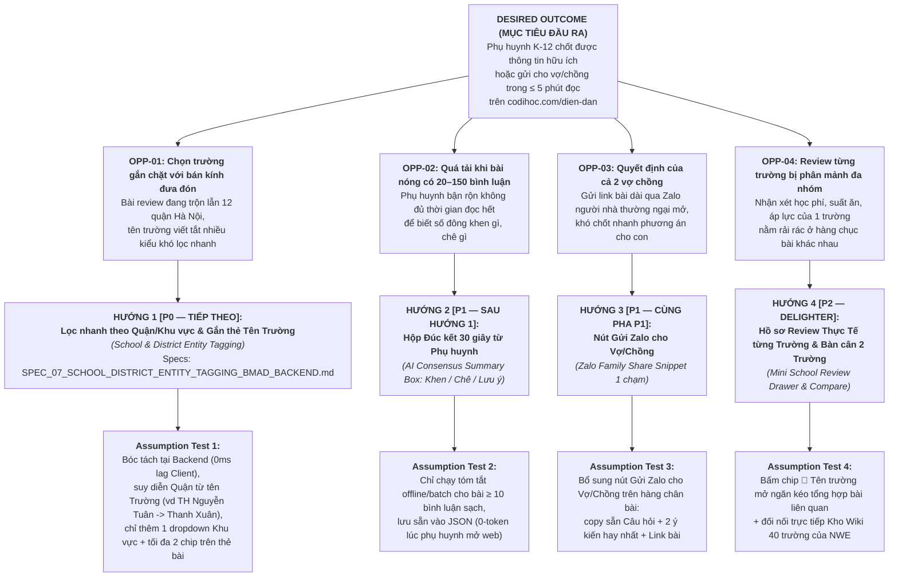

# 🧭 KIM CHỈ NAM SẢN PHẨM DIỄN ĐÀN PHỤ HUYNH SẠCH (`codihoc.com/dien-dan`)

> **Vai trò của tài liệu này:** Đây là tài liệu Gốc (Single Source of Truth — SSOT) khóa chặt **mục tiêu giá trị phụ huynh** cho website [`dien-dan.html`](file:///c:/commandcenter/08_New_Way_Edu/website_codihoc/dien-dan.html). Mọi AI Agent và kỹ sư khi đề xuất hoặc lập trình tính năng mới đều **bắt buộc đối chiếu với cây JTBD – Kano – OST dưới đây** để bảo đảm không làm phình giao diện, không đi lệch nhu cầu thật của cha mẹ, và không tạo nợ kỹ thuật.

---

## 1. Việc Cần Làm Cốt Lõi Của Phụ Huynh (Core Job-To-Be-Done — JTBD)

> *"Khi tôi đang rối vì chuyện học hành hoặc chọn trường cho con, hãy giúp tôi **nghe được kinh nghiệm thật của những bố mẹ đi trước** có hoàn cảnh giống mình, để tôi **chốt được phương án trong 5–10 phút** và đem về bàn với vợ/chồng, thay vì mất cả buổi tối bơi trong hàng trăm bình luận rác và quảng cáo trá hình trên Facebook."*

### Phân rã 3 chiều JTBD
1. **Công việc Chức năng (Functional Job):** Tìm đúng người có con cùng độ tuổi, ở gần khu vực nhà mình, đã trải nghiệm thực tế ngôi trường hoặc phương pháp học mà mình đang phân vân để biết mặt tốt – mặt xấu thật sự.
2. **Công việc Cảm xúc (Emotional Job):** Giải tỏa tâm lý hoang mang, bớt cảm giác cô đơn hay áp lực *"mình đang làm sai cho con"*, và yên tâm tuyệt đối rằng nội dung đang đọc không phải do đội ngũ bán hàng dàn dựng.
3. **Công việc Xã hội (Social Job):** Chắt lọc nhanh được 1–2 luận điểm đắt giá nhất để gửi qua Zalo cho vợ/chồng hoặc ông bà cùng đọc và đi đến thống nhất trong gia đình.

---

## 2. Bộ Tiêu Chí Đo Lường Thành Công Theo Ngôn Ngữ Tự Nhiên Của Phụ Huynh (`Kano Model × Desired Outcomes`)

Để kiểm chứng xem một tính năng mới có thực sự hữu ích hay chỉ là đồ trang trí thừa, ta đo bằng **3 tầng trải nghiệm** đứng từ góc nhìn của chính phụ huynh:

### Tầng 1: Điều kiện Cần — Không có là thoát trang ngay (`Kano Must-Be` + Giảm rủi ro)
- **"Đọc không sợ bị sale/seeding dắt mũi":** Bài và bình luận phải là của phụ huynh thật, giáo viên thật; loại bỏ kịch bản trung tâm tự hỏi tự khen hoặc thả link ẩn.
- **"Mở bình luận ra là đọc được luôn, không phải lội qua 50 cái chấm (`.`), `ib`, `xin giá`":** Bình luận nào hiển thị trên màn hình là bình luận mang thông tin thực chất.
- **"Tìm tên trường, khu vực hay tuổi của con là ra ngay":** Gõ *"Thanh Xuân"*, *"Nguyễn Tuân"*, *"bé 2021"* là lọc trúng ngay cụm bài mình cần, không bị trôi mất như trên Facebook Group.
- **"Lướt bằng điện thoại lúc nghỉ trưa/đợi đón con thấy nhẹ mắt":** Giao diện thoáng, chữ rõ, không quảng cáo nhảy khung, mở đọc bài và bình luận tức thì.

### Tầng 2: Thước đo Hiệu suất — Càng làm tốt phụ huynh càng quay lại (`Kano Performance` + Giảm thời gian)
- **"Đọc 5 phút biết luôn trường này/cách này có hợp với con và ví tiền nhà mình không":** Nhìn thấy rõ cả điểm khen lẫn góc khuất thực tế (học phí phát sinh, áp lực bài tập, suất ăn bán trú, sĩ số, phong cách cô giáo).
- **"Nắm được ngay số đông bố mẹ đi trước khuyên nghiêng về hướng nào":** Với các câu hỏi phân vân (công lập hay tư thục, học tiền tiểu học sớm hay không, đóng quỹ lớp mức nào), đọc xong thấy ngay 2–3 luồng quan điểm chính cùng lý do của từng bên.
- **"Lưu lại hoặc gửi cho chồng/vợ đọc chung trong 1 chạm":** Gặp đúng bài giải quyết nỗi đau của con là chép gọn được ý chính để gửi sang Zalo người nhà đọc ngay mà không cần đăng nhập.
- **"Đọc xong thấy nhẹ lòng, biết cách cư xử khéo với cô và con":** Có cả tiếng nói phản biện từ phụ huynh lẫn tâm sự thực tế từ giáo viên để giữ góc nhìn cân bằng, bớt cực đoan.

### Tầng 3: Điểm chạm "Wow" — Khiến phụ huynh tự truyền miệng (`Kano Delighters / Attractive`)
- **"Đỡ phải đọc 100 bình luận vì đã có sẵn 3 dòng tóm tắt: Khen gì – Chê gì – Lưu ý gì":** Chắt lọc sẵn tinh hoa của cả chuỗi tranh luận dài đặt ngay trên phần bình luận.
- **"Đang đọc bài nhắc tới trường nào, bấm vào là xem được hết review về trường đó":** Gom toàn bộ lời khen/chê rải rác từ hàng chục hội nhóm về đúng một ngăn kéo hồ sơ trường.
- **"Đặt 2 trường đang phân vân lên bàn cân":** Phụ huynh rất hay hỏi *"Trường A so với Trường B thế nào?"* — nhìn thấy ngay đối sánh thực tế từ các bố mẹ từng chuyển trường hoặc có con học tại cả hai nơi.

---

## 3. Cây Cơ Hội – Giải Pháp (`Teresa Torres Opportunity Solution Tree — OST`)

Mọi cải tiến sản phẩm trong tương lai của diễn đàn `Cò Đi Học` phải xuất phát từ một nút Cơ hội (Opportunity) đã được chứng minh từ hành vi phụ huynh, tuyệt đối không code tính năng theo cảm hứng nhất thời:

---

## 4. Lộ Trình Lưu Trữ 4 Hướng Tính Năng Chiến Lược (`Backlog Chính Thức`)

| Thứ tự | Mã Hướng | Tên Tính Năng & Vấn Đề Giải Quyết | Giải Pháp Thiết Kế Cốt Lõi (Chống Rối UI & Chống Nợ Kỹ Thuật) | Trạng Thái Hiện Tại |
| :---: | :--- | :--- | :--- | :--- |
| **1** | `SOL-01` | **Lọc nhanh theo Quận/Khu vực & Gắn thẻ Tên Trường** *(School & District Entity Tagging)* | Bóc tách 12 Quận Hà Nội + danh mục Trường Mầm non/Tiểu học/THCS **ngay tại Backend build-time** vào trường riêng `post.entities` (không trộn lẫn vào 20 `#Tag`). Tích hợp **suy diễn Quận từ Trường** (nhắc *TH Nguyễn Tuân* tự nhận diện *Thanh Xuân*). Trên UI giữ thanh điều khiển gọn 1 dòng bằng menu `📍 Khu vực` và gắn chip `📍 Quận` / `🏫 Trường` bấm được ngay trên bài viết. | **Đang làm Spec BMAD + Backend (`SPEC_07`)** — Sẵn sàng triển khai pha kế tiếp |
| **2** | `SOL-02` | **Hộp "Đúc kết 30 giây từ Phụ huynh"** *(AI Consensus Summary Box)* | Dành riêng cho bài có `clean_comments_count >= 10`. Sinh sẵn tại Backend (chế độ batch qua Subagent, tuyệt đối không gọi API khi người dùng lướt web) đúng 3 dòng súc tích đặt trên khung bình luận: **👍 Điểm khen nhiều nhất \| ⚠️ Điểm cần lưu ý \| 💡 Lời khuyên thực tế nhất**. | **Planned (P1)** — Thiết kế Schema mở rộng `post.ai_summary` |
| **3** | `SOL-03` | **Nút "Gửi Zalo cho Vợ/Chồng"** *(Zalo Family Share Snippet)* | Đặt nút gọn ngay trên hàng chân bài viết 1 dòng (`Xem thêm · Nguồn bài gốc · Gửi Zalo · X bình luận`) để đóng gói sẵn tin nhắn Zalo chuẩn giọng tự nhiên gồm: **Tiêu đề/Câu hỏi chính + 2 bình luận hữu ích nhất + Link mở thẳng bài**. Phù hợp 100% cơ chế Static/Read-Only, không cần backend runtime. | **Planned (P1)** — Có thể làm song song hoặc nối tiếp ngay sau `SOL-01` |
| **4** | `SOL-04` | **Ngăn kéo "Hồ sơ Review Thực Tế từng Trường" & So sánh 2 Trường** *(Mini School Review Drawer)* | Tận dụng trực tiếp `post.entities.schools` từ Hướng 1 và dữ liệu 40+ trường của `NWE`. Khi phụ huynh bấm vào chip `🏫 Ngôi Sao` hay `🏫 TH Nguyễn Tuân`, có thể chọn **Lọc bài** hoặc **Mở Hồ sơ tổng hợp**: số bài viết liên quan, các chủ đề được hỏi nhiều nhất (học phí, bán trú, đầu vào, áp lực) và so sánh 2 trường cạnh nhau. | **Planned (P2 — Delighter)** — Phụ thuộc nền tảng Entity ID sạch của Hướng 1 (`SOL-01`) |
| **5** | `SOL-05` | **Lưu bài viết cá nhân (`Bookmark`) & Hồ sơ Đồng hành** *(Member Auth Phase)* | Theo chỉ đạo CEO (`2026-11-13`), tạm gỡ nút `Lưu bài` / `Đã lưu` trên giao diện công cộng hiện tại (chân bài viết chỉ giữ 1 hàng siêu gọn: `Xem thêm · Nguồn bài gốc · Số lượng bình luận`). Khi xây dựng hệ thống **Quản lý Thành viên (Member Account / Đăng nhập)** sẽ mở lại tính năng lưu bài đồng bộ đa thiết bị theo tài khoản phụ huynh. | **Deferred (P3 — Member Auth)** — Chờ hệ thống Quản lý Thành viên |

---

## 5. Ràng Buộc Kiến Trúc Toàn Cục (Guardrails Cho Mọi Phiên Agent Sau)

1. **Giữ vững Giao diện Sạch, Thoáng & Siêu Gọn (`No Filter / Action Bloat`):** Không thêm khối hộp lọc to ở cột trái hay đầu bảng tin, và **thanh chân bài viết (`.post-actions-bar`) chỉ giữ 1 hàng ngang duy nhất** (`Xem thêm` · `Nguồn bài gốc` · `Số lượng bình luận`). Mọi bộ lọc mới phải gắn vào 1 dòng điều khiển `.filter-toolbar` hoặc đặt dưới dạng chip thực thể bấm được trên thẻ bài.
2. **Làm Nặng Ở Backend Build-Time, Giữ Nhẹ 100% Ở Frontend:** Toàn bộ phân tích NLP/Regex, phân loại chủ đề, chuẩn hóa thực thể Quận/Trường, tóm tắt bình luận phải thực hiện 1 lần khi xuất `clean_forum_feed.json` (và qua `/api/clean-feed`). Trình duyệt trên điện thoại chỉ lọc mảng có sẵn trong tích tắc ($O(1)$).
3. **Tách Bạch Tầng Dữ Liệu (`Orthogonal Data Schema`):** Không trộn lẫn nhiều loại ngữ nghĩa vào chung 1 mảng. Hiện tại: `topic_id` (6 Chủ đề lớn), `tags` (20 Thẻ nỗi đau/bối cảnh), tương lai `entities` (Quận & Trường), `ai_summary` (Đúc kết 30s) phải nằm ở các khóa JSON tách rời để tương thích ngược 100%.
4. **Kiểm Định Bằng Thước Đo Thực Tế Trước Khi Đóng Tác Vụ:** Mọi thay đổi mã nguồn sau này đều phải chạy `pytest` ở Backend và `verify_website_spec.py` + Playwright kiểm tra 3 khung hình (`1440x900`, `768x1024`, `375x812`, Sáng + Tối) trước khi deploy Vercel.
