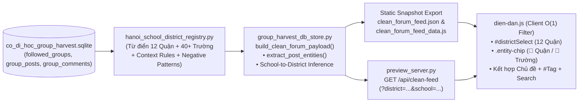

# 🏗️ SPEC-07: BẢN VẼ KIẾN TRÚC BMAD & BACKEND — LỌC NHANH THEO QUẬN/KHU VỰC & GẮN THẺ TÊN TRƯỜNG (`SOL-01`)

> **Tài liệu chiến lược gốc:** [`FORUM_PRODUCT_STRATEGY_JTBD_KANO_OST_ROADMAP.md`](file:///c:/commandcenter/08_New_Way_Edu/website_codihoc/specs/FORUM_PRODUCT_STRATEGY_JTBD_KANO_OST_ROADMAP.md)  
> **Nguyên tắc tối thượng (Zero Technical Debt):** Tính năng mới **KHÔNG ĐƯỢC PHÉP** làm phình UI 2 cột hiện tại, **KHÔNG ĐƯỢC PHÉP** làm ô nhiễm mảng `20 #Tag` chủ đề đang ổn định, và **KHÔNG ĐƯỢC PHÉP** chạy regex phân tích văn bản nặng nề trên trình duyệt điện thoại của phụ huynh.

---

## 1. Phân Tích 4 Nguy Cơ Nợ Kỹ Thuật & Quy Tắc Bảo Toàn Kiến Trúc

| STT | Nguy cơ Nợ Kỹ thuật (Technical Debt) | Hậu quả nếu làm ẩu | Chốt chặn Thiết kế Bắt buộc (Architecture Guardrail) |
| :---: | :--- | :--- | :--- |
| **1** | **Ô nhiễm hệ `#Tag` hiện tại** | Nhồi 12 Quận + 40+ Trường vào mảng `post.tags` khiến thanh `#quickTagsBar` 1 dòng bị loãng, đếm sai `20` thẻ nỗi đau và vỡ giới hạn `2 thẻ/bài`. | **Tách trục dữ liệu trực giao (`Orthogonal Facets`):** Giữ nguyên `post.topic_id` (6 chủ đề) và `post.tags` (20 thẻ nỗi đau). Thêm khóa mới độc lập `post.entities = { districts: [...], schools: [...] }`. |
| **2** | **Lag trên Mobile do xử lý ở Frontend** | Chạy 60+ Regex tiếng Việt trên `1,848` bài + `3,607` bình luận ngay trong `dien-dan.js` mỗi lần tải trang làm khựng cuộn trang. | **Build-Time Backend Pre-computation:** Mọi bóc tách Quận & Trường chạy **1 lần duy nhất tại Backend Python** khi xuất `clean_forum_feed.json` / `GET /api/clean-feed`. Trình duyệt chỉ đọc ID mảng sẵn với độ phức tạp $O(1)$. |
| **3** | **Nhận diện nhầm tiếng Việt (False Positives)** | `"Kim Đồng"` (NXB Kim Đồng / phố Kim Đồng vs `TH Kim Đồng`), `"Ngôi Sao"` (bài hát/bầu trời vs `Ngôi Sao Hà Nội`), `"Cầu Giấy"` (Quận vs `THCS Cầu Giấy`), `"Mỹ Đình"` không có chữ `"Nam Từ Liêm"`. | **Từ điển Ngữ cảnh (`hanoi_school_district_registry.py`) + Suy diễn Quận từ Trường (`School-to-District Inference`):** Quy định rõ `include_patterns`, `context_required_patterns` (ví dụ đòi từ khóa `trường`, `tiểu học`, `con học`, `học phí`), `exclude_patterns`, và tự động ánh xạ Trường $\to$ Quận. |
| **4** | **Phá vỡ giao diện 2 cột gọn nhẹ (`176b78f`)** | Vẽ thêm khối bảng Quận/Trường to trên cột trái hoặc hộp filter cao ngất ở đầu bảng tin sẽ quay lại vết xe đổ UX chật chội. | **UI Tiêm Siêu Gọn (`Minimal UI Footprint`):** Chỉ thêm đúng 1 menu chọn `📍 Khu vực: Tất cả ▾` (`.district-select`) cạnh nút `Sắp xếp` trên `.toolbar-top-row` và gắn tối đa `1–2` chip thực thể mảnh (`📍 Thanh Xuân`, `🏫 TH Nguyễn Tuân`) bấm được ngay trên thẻ bài. |

---

## 2. Quy Trình 4 Bước BMAD (`/bmad-architecture-engine` × `/ak:backend-development`)

### 2.1. `[B]` BREAK DOWN — Bóc tách 3 Cấp Độ Từ Trên Xuống (`Top-Down`)

#### Cấp độ 1: Đầu ra & Số liệu Thực chứng Đã Đo Đạc (`1,848` bài viết sạch hiện tại)
Khi rà soát mẫu trực tiếp trên kho [`clean_forum_feed.json`](file:///c:/commandcenter/08_New_Way_Edu/website_codihoc/assets/data/clean_forum_feed.json) (`1,848` bài sạch), mật độ nhắc tới địa bàn và tên trường đủ lớn để lọc cực kỳ hữu ích:
- **Theo Quận/Khu vực Hà Nội (12 quận nội/ngoại thành trọng điểm):**
  - Hoàng Mai (`135` bài), Cầu Giấy (`105` bài), Hà Đông (`84` bài), Ba Đình (`61` bài), Thanh Xuân (`56` bài), Nam Từ Liêm (`45` bài), Đống Đa (`41` bài), Hai Bà Trưng (`27` bài), Long Biên (`27` bài), Tây Hồ (`24` bài), Bắc Từ Liêm (`9` bài), Hoàn Kiếm (`5` bài).
- **Theo Tên Trường tiêu biểu đã xuất hiện dày đặc:**
  - Ngôi Sao (`39` bài), Archimedes (`21` bài), Đoàn Thị Điểm (`19` bài), TH Nguyễn Tuân (`19` bài), THCS & THPT Nguyễn Tất Thành (`17` bài), Nguyễn Siêu (`15` bài), Newton (`15` bài), TH/THCS Yên Hòa (`14` bài), Marie Curie (`13` bài), Lương Thế Vinh (`10` bài), Olympia (`8` bài), Vinschool (`6` bài), THPT Chuyên Hà Nội - Amsterdam (`5` bài), TH Dịch Vọng (`4` bài), TH Kim Đồng (`3` bài), TH Phan Đình Giót (`3` bài), Phenikaa (`2` bài), Alpha School (`2` bài)...

#### Cấp độ 2: Phân rã 4 Trạm Dây Chuyền (`Input -> Logic -> Output`)
1. **Trạm 1 — Sổ cái Thực thể Chuẩn hóa (`hanoi_school_district_registry.py`):**
   - *Input:* Bộ cấu hình tĩnh gồm `HANOI_DISTRICT_REGISTRY` (12 quận + các phường/đô thị vệ tinh như *Linh Đàm, Mễ Trì, Mỹ Đình, Times City, Văn Quán, Ngoại Giao Đoàn...*) và `HANOI_SCHOOL_REGISTRY` (nhóm trường công lập, CLC, tư thục, song ngữ Hà Nội gắn sẵn `district_slug` chủ quản).
   - *Logic:* Cung cấp cấu trúc bất biến, không chứa logic I/O hay phụ thuộc SQLite/Web.
   - *Output:* Danh sách rule chuẩn hóa biên dịch sẵn `re.compile()` khi import module.
2. **Trạm 2 — Động cơ Bóc tách & Suy diễn Quận (`extract_post_entities` trong Backend):**
   - *Input:* `post_text`, `group_name`, `clean_comments` của 1 bài viết sạch.
   - *Logic:* Quét bài viết (ưu tiên trọng số cao cho `post_text` và `group_name`, bổ sung `clean_comments`), đối chiếu `exclude_patterns` để triệt tiêu nhiễu ngữ nghĩa (ví dụ `"NXB Kim Đồng"`, `"sao trên trời"`), sau đó chạy bước **Suy diễn Quận từ Trường** (nếu khớp `TH Nguyễn Tuân` hoặc `TH Phan Đình Giót` $\implies$ tự động nạp `thanh_xuan` vào `districts`).
   - *Output:* Object `{ "districts": [...], "schools": [...] }` (giới hạn tối đa `2` quận và `3` trường sát nhất/bài, kèm `inferred_from_school: true/false`).
3. **Trạm 3 — Hợp đồng Dữ liệu JSON & REST API (`group_harvest_db_store.py` & `preview_server.py`):**
   - *Input:* Dữ liệu tổng hợp trong `build_clean_forum_payload()` và HTTP Request từ `preview_server.py`.
   - *Logic:* Gắn thêm `summary.entity_stats`, `districts` (danh mục quận kèm đếm bài), `schools` (danh mục trường có $\ge 1$ bài) ở cấp gốc JSON và `post.entities` ở từng bài viết. Trên `preview_server.py`, hỗ trợ query parameters tùy chọn `?district=<slug>&school=<slug>` trên `GET /api/clean-feed` (nếu không truyền tham số thì trả toàn bộ payload như cũ để giữ 100% tương thích ngược với static JSON).
   - *Output:* `clean_forum_feed.json`, `clean_forum_feed_data.js`, và HTTP `200 OK` JSON.
4. **Trạm 4 — Bộ Lọc Trực Giao & Chip Thực Thể Trên Giao Diện (`dien-dan.html`, `dien-dan.js`, `dien-dan.css`):**
   - *Input:* `state.data.districts`, `state.data.schools`, `post.entities`.
   - *Logic:* Mở rộng `state` với `districtSlug: "ALL"` và `schoolSlug: "ALL"` hoàn toàn độc lập với `topicId` và `tagSlug`. Phụ huynh có thể lọc kết hợp cùng lúc (ví dụ: Chủ đề *Chọn trường & Tuyển sinh* $\times$ Khu vực *Thanh Xuân* $\times$ Trường *TH Nguyễn Tuân*), xem chip đang lọc tại `#activeFilterChips` và bấm nút `Xóa bộ lọc` để hoàn nguyên ngay.
   - *Output:* Thẻ bài viết hiển thị gọn `📍 Quận` + `🏫 Trường` bấm được ngay trên `.topic-pill-row` (hoặc dòng chip phụ tinh gọn) mà vẫn giữ nguyên khung 2 cột.

#### Cấp độ 3: Phân tách Tư duy vs Máy móc
- **Phân định rõ:** Khâu cập nhật danh bạ trường học mới (từ `40` trường lên `80+` trường hoặc thêm biệt danh phụ huynh hay gọi như *"Ngôi Sao Hoàng Minh Giám"*, *"Arc Cầu Giấy"*) thuộc về tri thức biên tập; còn khâu khớp từ khóa theo ngữ cảnh, suy diễn Quận từ Trường, đếm tổng bài và kiểm tra định dạng JSON là **Chốt chặn cơ học 100% Python**.

---

### 2.2. `[M]` MODEL — Lắp Ghép Kiến Trúc & Hợp Đồng Dữ Liệu (`Backend API & JSON Contract`)

#### A. Sơ đồ Dây Chuyền Dữ Liệu Một Chiều (`DAG Flowchart`)



#### B. Hợp Đồng Tệp Tin Kho Nhà & Module Mới Đề Xuất

| Thành phần | Tệp tin sở hữu | Trách nhiệm duy nhất (Single Responsibility) |
| :--- | :--- | :--- |
| **Từ điển thực thể** *(Tạo mới khi thi công)* | `02_AI_Hub/Warehouse/Capability_Store/Postiz_Social_Publisher/hanoi_school_district_registry.py` | Lưu `HANOI_DISTRICTS` & `HANOI_SCHOOLS` kèm alias, context guard và `district_slug` chủ quản. |
| **Động cơ bóc tách** *(Mở rộng có kiểm soát)* | `02_AI_Hub/Warehouse/Capability_Store/Postiz_Social_Publisher/group_harvest_db_store.py` | Bổ sung `extract_post_entities()`, gọi từ `build_clean_forum_payload()` mà không sửa đổi logic lọc seeding/markdown cũ. |
| **API Cục bộ** *(Mở rộng tương thích ngược)* | `08_New_Way_Edu/website_codihoc/preview_server.py` | Hỗ trợ lọc tùy chọn `?district=&school=&topic=&limit=` (nhập an toàn theo allowlist slug, trả lỗi `400` nếu tham số bất thường) khi gọi `/api/clean-feed`. |
| **Giao diện đọc** *(Mở rộng 2 cột hiện có)* | `website_codihoc/dien-dan.html`, `assets/js/dien-dan.js`, `assets/css/dien-dan.css` | Thêm `#districtSelect` trên `.toolbar-top-row` và render `.entity-chip` có fallback an toàn nếu bài viết không có trường `entities`. |

#### C. Đặc tả JSON Schema Tương Thích Ngược (`clean_forum_feed.json v2.1`)

```json
{
  "generated_at": "2026-11-13 18:00:00 +07:00",
  "mode": "READ_ONLY_CLEAN_FORUM",
  "schema_version": "2.1",
  "districts": [
    { "slug": "hoang_mai", "label": "Hoàng Mai", "count": 135 },
    { "slug": "cau_giay", "label": "Cầu Giấy", "count": 105 },
    { "slug": "ha_dong", "label": "Hà Đông", "count": 84 }
  ],
  "schools": [
    { "slug": "ngoi_sao_ha_noi", "label": "Ngôi Sao Hà Nội", "district_slug": "thanh_xuan", "school_type": "private", "count": 39 },
    { "slug": "th_nguyen_tuan", "label": "TH Nguyễn Tuân", "district_slug": "thanh_xuan", "school_type": "public", "count": 19 }
  ],
  "posts": [
    {
      "post_sig": "...",
      "topic_id": "CHON_TRUONG_TUYEN_SINH",
      "tags": [
        { "slug": "review-truong-cong", "label": "#TrườngCôngLập" }
      ],
      "entities": {
        "districts": [
          { "slug": "thanh_xuan", "label": "Thanh Xuân", "inferred": true }
        ],
        "schools": [
          { "slug": "th_nguyen_tuan", "label": "TH Nguyễn Tuân", "district_slug": "thanh_xuan" }
        ]
      }
    }
  ]
}
```

#### D. Đặc tả Chuẩn `/ak:backend-development` Cho API `/api/clean-feed`
1. **Input Validation (Allowlist):** Giá trị query `district` và `school` chỉ chấp nhận chuỗi `[a-z0-9_]{1,64}` hoặc kiểm tra trực tiếp trong `VALID_DISTRICT_SLUGS` / `VALID_SCHOOL_SLUGS`; mọi ký tự lạ phải trả HTTP `400 Bad Request` kèm JSON chuẩn `{ "ok": false, "error": "invalid_entity_filter" }` (tuyệt đối không nội suy chuỗi vào SQL).
2. **Preserve Read-Only Authority:** `preview_server.py` chỉ chấp nhận phương thức `GET`, từ chối mọi mutation (`POST/PUT/DELETE` trả `405 Method Not Allowed`), giữ nguyên `Cache-Control: no-store`.
3. **Zero-Config Static Fallback:** Khi deploy lên Vercel Static (`codihoc.com/dien-dan`), không phụ thuộc server Python; `dien-dan.js` tự đọc trực tiếp `districts`, `schools` và `post.entities` từ `clean_forum_feed_data.js` / `clean_forum_feed.json` với `safeArray` fallback nếu tệp JSON phiên bản cũ chưa có trường `entities`.

---

### 2.3. `[A]` AUTOMATE — 5 Kịch Bản Lỗi Biên & Chốt Chặn Cơ Học Chống Sai

| Kịch bản biên (Edge Case) | Chốt chặn cơ học (`pytest` & Harness) |
| :--- | :--- |
| **E1. Nhiễu từ đồng âm tiếng Việt** (*"Mua sách ở NXB Kim Đồng"*, *"Ngắm ngôi sao trên trời"*, *"Đi qua đường Hoàng Quốc Việt ăn phở"*) | Bộ test `test_entity_false_positives` bắt buộc khẳng định trả về `schools = []`, chỉ khớp `TH Kim Đồng` hoặc `Ngôi Sao Hà Nội` khi đi kèm ngữ cảnh học đường (`trường`, `tiểu học`, `con học`, `tuyển sinh`, `bán trú`, `học phí`, `lớp 1`). |
| **E2. Phụ huynh chỉ gõ tên Trường/Phường, quên gõ tên Quận** (*"Con mình định vào TH Nguyễn Tuân..."*, *"Khu Mễ Trì Hạ có trường mầm non nào ổn?"*) | Bộ test `test_school_and_ward_to_district_inference` xác minh `TH Nguyễn Tuân` $\implies$ `thanh_xuan` (`inferred=True`) và `Mễ Trì` $\implies$ `nam_tu_liem`. |
| **E3. Tương thích ngược với Frontend cũ** (`clean_forum_feed.json` thiếu khóa `entities` hoặc `entities: null`) | Trong `dien-dan.js`, hàm đọc thực thể dùng `(post.entities && Array.isArray(post.entities.districts)) ? post.entities.districts : []`; không bao giờ ném `TypeError` hoặc in chuỗi `undefined`. |
| **E4. Rối chip trên thẻ bài khi bài liệt kê 5–6 trường cùng lúc** | Ràng buộc cứng: mỗi thẻ bài hiển thị tối đa **1 chip Quận + 2 chip Trường** (`MAX_DISTRICT_CHIPS = 1`, `MAX_SCHOOL_CHIPS = 2`), nếu nhiều hơn gom phần còn lại vào tooltip `title` hoặc đếm `+N trường khác`. |
| **E5. Vỡ thanh công cụ 1 dòng trên Desktop/Mobile** | Cổng Playwright `run_once_verify_dien_dan_ui.py` kiểm tra `.filter-toolbar` giữ chiều cao $\le 115\text{px}$ trên Desktop (`1440px`), `horizontalOverflow = false` trên Mobile (`375px`) và toàn bộ chữ trên `#districtSelect` không bị tràn. |

---

### 2.4. `[D]` DELIVER — Ma Trận Quyết Định Kiến Trúc (`Decision Matrix — 3 Phương Án Đối Trọng`)

*(Tuân thủ `Single-Option VETO` của Cổng Tổng `/audit` và `/bmad-architecture-engine`)*

| Tiêu chí Đánh giá | Phương án A: Chạy Regex lọc Quận/Trường ở Frontend (`dien-dan.js`) | Phương án B: Nhồi chung 12 Quận + 40 Trường vào mảng `post.tags` hiện có | **Phương án C (ĐỀ XUẤT): Backend Build-Time Pre-computed Orthogonal Entities (`post.entities`)** |
| :--- | :---: | :---: | :---: |
| **Hiệu năng trên Mobile** | Kém (lặp 60+ Regex × 1,848 bài mỗi lần mở/lọc trang) | Tốt ($O(1)$) | **Tuyệt đối ($O(1)$, `0ms` Regex ở Client)** |
| **Bảo toàn hệ `#Tag` hiện tại** | Tốt | Rất kém (làm nát 20 `#Tag` & thanh 1 dòng `#quickTagsBar`) | **Tốt 100% (`topic_id`, `tags`, `entities` tách biệt)** |
| **Độ chính xác tiếng Việt (Chống nhiễu & Suy diễn Quận)** | Yếu (khó bảo trì từ điển ngữ cảnh bằng JS thuần) | Yếu (không phân biệt được loại thực thể) | **Cao nhất (từ điển Python có negative guard + suy diễn Quận từ Trường + test `pytest`)** |
| **Tương thích Hướng 4 (`Mini School Review Drawer`)** | Không có ID trường chuẩn hóa | Khó tách riêng danh bạ trường | **Dùng lại 100% `school_slug` & bảng `schools` để mở ngăn kéo hồ sơ trường** |
| **Nguy cơ tạo Nợ Kỹ thuật** | Cao | Rất cao | **Gần như bằng 0 (Tách module `hanoi_school_district_registry.py`)** |

---

## 3. Kế Hoạch Triển Khai Chia Pha Khi CEO Duyệt Thi Công (`Execution Checklist`)

- **Pha 1 (Backend Registry & Extractor):** Tạo `hanoi_school_district_registry.py` + hàm `extract_post_entities()` trong `group_harvest_db_store.py` + viết `pytest` cho E1–E2, chạy xuất lại `clean_forum_feed.json` và đối soát độ chính xác thủ công trên 30 bài mẫu.
- **Pha 2 (API & Static Export Sync):** Cập nhật `preview_server.py` (hỗ trợ `?district=&school=` với allowlist validation) và chạy `fb-group-export-web`.
- **Pha 3 (Frontend UI Integration):** Cập nhật `dien-dan.html`, `dien-dan.js`, `dien-dan.css` (thêm `#districtSelect` cạnh `#sortSelect`, hiển thị chip `📍 Quận` / `🏫 Trường` bấm lọc tức thì), giữ nguyên cấu trúc 2 cột `680px`.
- **Pha 4 (Verification & Release):** Chạy `pytest` + Playwright 3 khung hình (Light + Dark) + `verify_website_spec.py` (`5/5 GATES PASSED`) trước khi commit GitHub và deploy Vercel.
